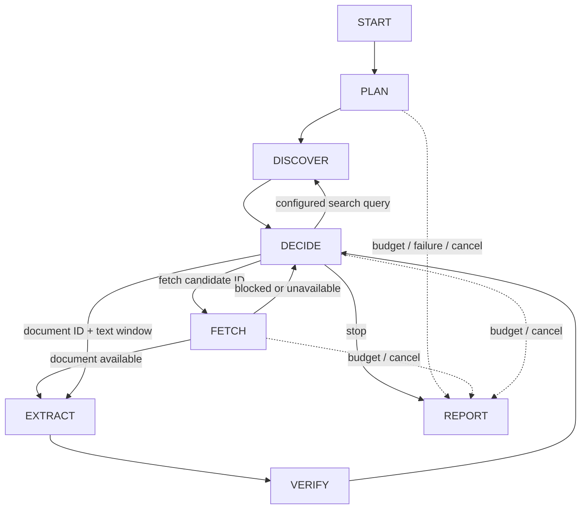

# ATLAS research agent engine

Task 2 extends the existing application. The opportunity directory, profile/matching, shortlist, manual imports, and human review history remain separate and operational. Research is not automatically promoted into reviewed opportunities.

## Execution and decisions



`engine.py` compiles an actual LangGraph with conditional edges. There is one orchestrated agent, not a hierarchy of agent wrappers. In live mode:

1. **PLAN** requests a typed `PlanSpec` from the configured language model: questions, fields, constraints, search tasks, and completion criteria.
2. **DISCOVER** registers explicit starting URLs, or executes a model-selected query against the optional configured SearxNG adapter. Source links come from retrieved documents; the model cannot invent a fetch URL.
3. **DECIDE** sends current evidence, unknowns, conflicts, candidates, source failures, available actions and remaining counters to the model. Its structured `Decision` selects fetch, search, re-extraction, or stop. An optional full plan revision must retain the original required fields. Rejected targets become observable feedback, not a tool execution.
4. **FETCH** invokes a bounded source tool, records retrieval metadata, normalizes HTML/PDF, and adds in-scope document links as candidates. New links and failures change the next model decision.
5. **EXTRACT** requests typed claims and exact supporting/scope quotations. Inputs contain at most a 30,000-character window plus short header context. Re-extraction can select another document window and focus on a question; each document allows two extraction passes.
6. **VERIFY** mechanically checks exact unambiguous spans, the value phrase, program/intake scope, and omitted negation/qualification markers. It compares conservative normalized propositions and records possible conflicts. Verification does not ask the model to agree with itself.
7. **REPORT** deterministically compiles the supported evidence ledger, unresolved questions, conflicts and limitations. Unsupported candidates stay inspectable but are excluded from report findings. An answer is partial when evidence is missing/conflicting or execution is interrupted/limited.

The executive summary is an evidence-count synthesis, not uncited model prose. Reports and decisions never contain admissions probabilities or private model reasoning. Hidden provider reasoning fields are not read. Source text is explicitly marked untrusted data in model prompts. Permissions, budgets, schemas, and dispatch are enforced by application code regardless of model behavior.

## What is genuinely model-driven

`OpenAICompatibleProvider` implements real POST requests to the administrator-configured `/chat/completions` endpoint. The model creates the plan, extracts candidates, selects tools, chooses text windows/questions, revises the plan and decides when to stop. This path is tested against a controlled HTTP endpoint. A real model endpoint was not available/used during this implementation, and the user selected offline verification. Actual live planning quality, research strategy quality, and real-site connectivity remain **unverified**.

The **offline demo** explicitly uses `DemoProvider` and `DemoFetcher`: deterministic decisions over fictional bundled documents. The first document omits proof-of-funds information; the new evidence exposes a handbook link; the next decision investigates it and revises the plan. Alternative scenarios retain conflicts or an unknown. This exercises the graph and persistence, but is not autonomous LLM research and does not establish facts about a real program.

The default behavior never silently substitutes demo results after a live provider error.

## Stored state and evidence

Migration `0002` only adds research tables; it does not rewrite Task 1 tables/data.

| Table | Purpose |
| --- | --- |
| research_runs | UUID, objective, mode, lifecycle, limits, cancellation flag, counters, latest graph-state snapshot, timestamps, error/stop reason |
| research_plans | Typed plan JSON by run/revision |
| research_steps | Ordered node events, observable summaries, action metadata and application-level node-boundary checkpoints |
| research_candidates | Explicit seed/link/search candidates with bounded scope and fetch status |
| research_documents | Reusable source versions: canonical URL + raw SHA-256, original bytes, normalized text, links, PDF page spans, retrieval/check dates |
| research_sources | Per-run source use, retrieval failures, cache usage, document links |
| research_evidence | Exact normalized-text offsets/excerpts, document version, support or scope purpose, location metadata |
| research_claims | Model candidate value/scope, proposed quotes, validated evidence IDs, verification state, canonical comparison value |
| research_contradictions | Two cited claim IDs, field and observable conflict summary |
| research_reports | Frozen structured final/partial report per run |

Short-term run state and events are separate from reusable document versions. Within the cache TTL (default one hour), unchanged saved evidence can be reused across live runs; scope and robots policy are rechecked first, including a cached redirect target. Reuse preserves the last actual network-check timestamp. A fresh equal-hash retrieval updates `last_checked_at`; changed bytes create a new version. Cache reuse is not proof that a site remains unchanged. Demo fixture content is never reused through the live source cache.

`ResearchStep.checkpoint` and `ResearchRun.state` are durable application snapshots for inspection. This release does **not** configure a LangGraph persistent checkpointer or implement graph resumption. It does not claim to recover arbitrary in-flight nodes. After process interruption, pending/running runs become failed with an `interrupted` reason and inspectable partial artifacts. Starting a new run is required; no model request is automatically replayed. Scheduled monitoring and automatic resumption are future work.

## Verification states and limits of inference

- **source_supported**: exact support and scope quotations resolve to stored text; the value occurs in the quote; basic negation/qualifier omission checks pass. This is mechanical support, not semantic entailment or a truth guarantee.
- **corroborated**: compatible supported claims occur in distinct content hashes and explicitly caller-declared independent authority groups. This depends on the caller's independence assertions, not domain guessing or LLM agreement.
- **unverified**: candidate quotation, value or scope cannot be validated. These candidates never enter report findings.
- **contradictory**: supported same-program/same-intake claims have conflicting conservative values. Both remain cited; no winner is chosen automatically. Different intakes/currencies are not compared as though equivalent.
- **unknown**: a required plan field lacks supported evidence. Unknowns are report entries, not invented claims.

Comparisons currently support a small exact vocabulary for tuition coverage and proof of funds, ISO deadlines, and same-currency numeric application fees. Complex conditional prose may contain unresolved differences that are not automatically labeled contradictory. Award tracks and applicant subgroups are not yet full scope dimensions. Human source/context review remains required.

## Worker and budgets

FastAPI returns **202** with a stable run ID. A single in-process thread worker handles a queue of up to four submitted/running runs. Polling only reads saved state. Cancellation is checked between nodes, request chunks, budget reservations and rate-limit waits. An active blocking request can take its bounded timeout to stop (model timeout defaults to 20 seconds, max 30). There is no arbitrary background crawler.

Run lifecycle: `pending → running → completed / failed / cancelled`; `outcome` separately records `complete` or `partial`. Budget stops are completed investigations with partial outcomes. Source failures are observations for further decisions; provider failures terminate the run with a partial report.

Default/hard-maximum budgets:

| Budget | Default | Hard maximum |
| --- | ---: | ---: |
| DECIDE iterations | 6 | 12 |
| Source attempts (cache/failure attempts count) | 4 | 8 |
| Logical fetch/search/re-extract tool calls | 10 | 20 |
| Network requests, including robots/redirect/search | 24 | 40 |
| Provider requests including retries | 12 | 24 |
| Reserved completion tokens across provider attempts | 12,000 | 24,000 |
| Elapsed seconds | 120 | 180 |

Provider output allocation defaults to 1,800 tokens/request, bounded by remaining reservation; this is an upper reservation, not actual billed usage. Reported prompt/completion tokens are separate counters. Missing usage metadata is explicitly counted; ATLAS does not invent input token accounting or dollar costs. Offline provider-request/reservation counters represent fixture operations; real model and network request counts are zero. Source candidates are capped at 40, links inspected per document at 100, downloads at 2 MiB, normalized source text at 100,000 characters, and model input at 55,000 characters including schema/context.

## API

| Method and route | Behavior |
| --- | --- |
| GET /api/research/capabilities | Honest model/search/demo availability, no credential values |
| POST /api/research/runs | Validate objective/mode/seeds/scope/limits/consent; return 202 |
| GET /api/research/runs | Recent runs (bounded list) |
| GET /api/research/runs/{id} | Lifecycle, plan revisions, progress, counters/checkpoints |
| GET /api/research/runs/{id}/evidence | Claims, snippets, document metadata, unknowns and conflicts |
| GET /api/research/runs/{id}/documents/{document_id} | Saved normalized text belonging to that run |
| GET /api/research/runs/{id}/report | Final/partial report; 409 while pending |
| POST /api/research/runs/{id}/cancel | Request bounded, idempotent cancellation |

Optional `source_groups` maps approved exact hostnames to user-asserted independent authority labels. This advanced API setting is not generated by the model. Domains from seed URLs are included automatically; additional exact domains must be explicitly supplied. Without search configuration or seed candidates, live research can plan and stop with insufficient evidence; unrestricted search is never claimed.

## Running the demonstrations

```bash
# repository root; existing checkout, no new worktree
./scripts/setup.sh
./scripts/dev.sh
```

Open the local frontend on port 5173 and choose **Research agent → Offline synthetic demo → Start offline demo**. Inspect revision 2 and the second DECIDE event, read the report, inspect citations, and open saved source text. Try **Conflicting funding & deadline statements** and **Insufficient proof-of-funds evidence**. Reload a selected run to inspect the same saved artifacts. No credentials or external access are required.

Offline CLI evaluation:

```bash
cd backend
.venv/bin/python -m atlas.research.evaluate --output ../docs/evaluation-results.json
```

## Explicitly enabling a real model

The default remains disabled. This was not enabled or exercised against a real model in the prepared environment.

1. Run a compatible model service yourself, or choose an explicitly approved hosted service. No model is automatically downloaded and no paid account is activated.
2. Set the backend's configuration securely (see `.env.example`). For an already-running local Ollama-compatible service:

```dotenv
ATLAS_LLM_ENABLED=true
ATLAS_LLM_BASE_URL=http://127.0.0.1:11434/v1
ATLAS_LLM_MODEL=your-installed-model
ATLAS_LLM_JSON_MODE=json_object
```

For capable hosted endpoints, use HTTPS and `ATLAS_LLM_JSON_MODE=json_schema` (default). Supply `ATLAS_LLM_API_KEY` securely if required; never commit a credential or paste it into chat. Ambient proxy-backed bindings are supported for the configured model/search endpoints. Source fetching deliberately does not use ambient proxy credentials.

3. Restart the backend. In the Research screen select **Configured LLM research**, enter your actual objective and official seed URLs, add exact additional domains as needed, and consent explicitly to provider requests/data handling/costs. Use a structured-output-capable model. JSON/schema failures and temporary errors retry at most once within the same budget; configuration/access errors are not retried.
4. Optional broader search: configure `ATLAS_SEARCH_BASE_URL` for a SearxNG service supporting `/search?q=...&format=json`. Results still have to match the run's approved domains. No search service is bundled.

Opt-in live smoke test against the running local API:

```bash
cd backend
.venv/bin/python -m atlas.research.live_smoke \
  --allow-model-requests \
  --objective "Your specific research objective and questions, including the intended intake" \
  --seed 'https://your-approved-official-host.example/program'
```

Replace the example URL/objective with an accessible, approved real source. The command submits through the existing API, requires an enabled model, enforces a bounded run, and exits successfully only when a completed investigation used real provider requests and produced resolvable cited findings. A partial outcome may pass the transport/workflow smoke while leaving substantive questions unanswered. This command was **not run live** here. A proxy-only or restricted cloud network may prevent the DNS-pinned direct source transport from reaching official hosts; it fails closed rather than falling back to unsafe retrieval. Use the offline demo until the runtime supports the needed direct egress, or add a trusted source gateway in a later milestone.

## Next engineering milestone

Task 3 should first validate several approved live models/sites and evaluate model extraction against a larger human-labeled corpus. Then add award/track/applicant scope, semantic/context review, scoped retrieval windows, reviewed promotion into the directory, source diffs, and a durable job queue with idempotent, explicitly authorized resumption. Authentication and stronger parser isolation are prerequisites for public hosting.
